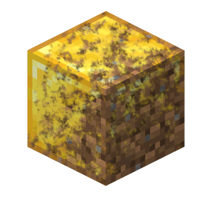

# Mod-Transmuder

*Turning gold into mud*\
\- 300f20t 2026

**Actually, it is just tools written in Java for porting Minecraft mods to newer versions.** You can download the automatic runtime porter (as a Minecraft mod), add `MT-layer-VERSION` for manual porting (as a lib for legacy mods) or **use the pipeline on mod src (recommended)**

Target input version: `1.7.10` Forge (`1.12.2` planned)

Target output version: `1.21.1` NeoForge and Fabric

You can try changing the version for experiments but that should not work.

**Check [PIPELINE.md](docs/PIPELINE.md) to get info about pipeline steps.**
